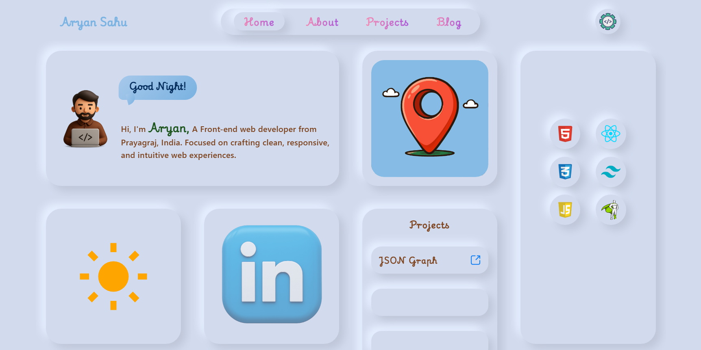
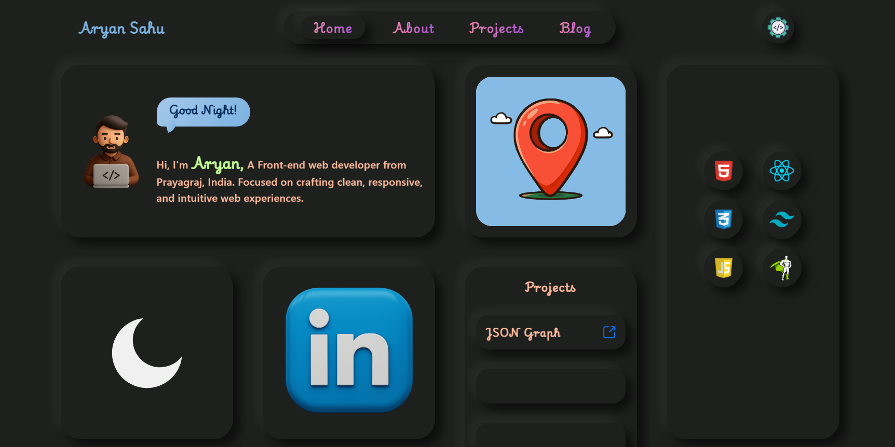

# Aryan Sahu | Portfolio

<p align="center">
  A modern, responsive personal portfolio built with HTML, CSS, and JavaScript, featuring a neumorphism-inspired UI, light and dark themes, and interactive elements.
</p>

<p align="center">
  <a href="https://aryansahu-portfolio.vercel.app/">
    
  </a>
  <a href="https://github.com/CodeAryann">
    
  </a>
  <a href="https://www.linkedin.com/in/aryansahu30">
    
  </a>
</p>

---

## ✨ Features

- 🎨 **Light & Dark Mode** — Switch between light and dark themes.
- 💎 **Modern UI** — Neumorphism-inspired design, soft shadows, and rounded corners.
- 📱 **Responsive Design** — Optimized for desktop, tablet, and mobile screens.
- 👋 **Dynamic Greeting** — Displays a greeting based on Indian Standard Time (IST).
- 🔗 **Social Links** — Quick access to GitHub and LinkedIn.
- 🚀 **Projects Showcase** — Showcases projects, including JSON Graph.
- ⏳ **Animated Loader** — Custom loading animation.
- 🧰 **Tech Stack & Tools** — Highlights technologies and development tools.

## 🖼️ Screenshots

<table>
  <tr>
    <th align="center">☀️ Light Mode</th>
    <th align="center">🌙 Dark Mode</th>
  </tr>
  <tr>
    <td width="50%">
      
    </td>
    <td width="50%">
      
    </td>
  </tr>
</table>

## 🛠️ Built With

<p align="center">
  
  
  
  
  
</p>

- **HTML5** — Website structure and content.
- **CSS3** — Styling, responsive layouts, animations, and visual effects.
- **JavaScript** — Theme switching, dynamic greetings, and interactive functionality.
- **Google Fonts** — Typography.
- **Vercel** — Hosting and deployment.

## 📂 Project Structure

```text
Portfolio/
├── assets/
├── screenshots/
├── index.html
├── README.md
├── script.js
└── styles.css
```

## 🚀 Getting Started

### Prerequisites

- A modern web browser.
- [Visual Studio Code](https://code.visualstudio.com/).
- [Git](https://git-scm.com/).

### Run Locally

1. Clone the repository:

   ```bash
   git clone https://github.com/CodeAryann/Portfolio.git
   ```

2. Navigate to the project directory:

   ```bash
   cd Portfolio
   ```

3. Open the project in VS Code:

   ```bash
   code .
   ```

4. Open `index.html` in your browser or use the Live Server extension.

## 🔗 Connect With Me

- **GitHub:** [CodeAryann](https://github.com/CodeAryann)
- **LinkedIn:** [Aryan Sahu](https://www.linkedin.com/in/aryansahu30)
- **Portfolio:** [aryansahu-portfolio.vercel.app](https://aryansahu-portfolio.vercel.app/)

## ⭐ Support

If you like this project, consider giving the repository a star! Your support is appreciated.
